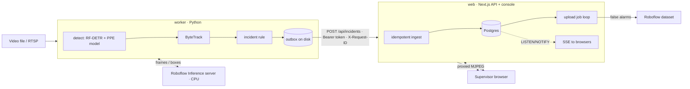

# Linewatch

Draw a zone on a camera view, catch people who walk into it without a hi-vis vest, review each
alert in one keystroke, and send false alarms back to a Roboflow project so the model can learn
from its mistakes.

A Python worker runs two detection models on the [Roboflow Inference](https://github.com/roboflow/inference)
server, tracks people, and turns flickering detections into one incident per person. A Next.js
console and API store incidents in Postgres, stream them live to supervisors, and deliver
false alarms to Roboflow for relabeling. Everything runs locally with Docker Compose on a CPU.

<!--  -->

## The problem

On a road crew or a warehouse floor, a supervisor can't watch every camera. Generic PPE detectors
draw boxes on every frame, which is not what a supervisor needs: one person without a vest
produces hundreds of flickering boxes. Linewatch turns detections into **one incident per person
per zone**, puts it in a review queue, and closes the loop back to the training data. An alert
system is only useful if alerts are neither lost nor doubled, so delivery between the services
is built to survive restarts, outages and retries.

## Architecture



| Service | Does | Talks to |
| --- | --- | --- |
| `inference` | Runs the models (Roboflow Inference CPU image, pinned to 1.8.0) | worker only |
| `worker` | Reads video, detects, tracks, applies the rule, writes incidents to its outbox, delivers them | inference, web |
| `web` | Console + REST API: login, ingest, review, zones, live view proxy, upload jobs, metrics | Postgres, worker, Roboflow |
| `db` | Postgres 16: incidents, zones, upload jobs, `schema_migrations` | web |

Only the console is published, on `127.0.0.1`. The worker's port (live stream, `/metrics`) and
the Inference server stay on the Compose network; browsers see the stream through the web app.

### Per frame, in the worker

1. Runs a person model (`rfdetr-small`) and a PPE model (`construction-site-safety/27`) in
   parallel on the Inference server.
2. Tracks people with ByteTrack so each person keeps an ID.
3. Checks whether the person's feet are inside the zone, and whether a vest box covers their box.
4. Fires an incident only when that person was in the zone without a vest in 4 of the last 6
   frames; then stays quiet for that person for 60 s. A new track that fires within one
   person-height of a live incident joins it (the tracker re-identified the same person).
5. Writes the incident (with a new UUID, an annotated snapshot and the clean frame) to the outbox.

## Reliability

| Failure | What happens |
| --- | --- |
| Web app down or restarting | Incidents wait in `out/outbox/pending/` (one fsynced file each, atomic rename) and are retried with exponential backoff and jitter, oldest first, also across worker restarts. |
| Worker never sees the response (timeout after the server stored it) | It sends again. The incident's UUID is the idempotency key: `INSERT … ON CONFLICT (id) DO NOTHING`, 201 the first time, 200 `duplicate: true` after. |
| Many copies of one incident at once | One row. Tested with 25 concurrent copies, and benchmarked below. |
| Web app rejects an incident (bad token, invalid payload) | 4xx other than 408/429 can't succeed by retrying: the file moves to `out/outbox/dead/` with the reason. `python -m linewatch.outbox replay` re-queues dead letters after the cause is fixed. |
| Worker stopped (`docker compose stop`) | SIGTERM drains the outbox for `DRAIN_SECONDS` (10 s); the rest stays on disk for the next start. |
| Roboflow down or slow | A review never waits on Roboflow. Marking a false alarm queues an upload job in the same `UPDATE`. A loop claims due jobs with `FOR UPDATE SKIP LOCKED` under a 60 s lease, retries transient errors (network, 408, 429, 5xx) with backoff up to `UPLOAD_MAX_ATTEMPTS`, and fails at once on errors retrying can't fix. |
| Web app dies mid-upload | The lease expires and the job is claimed again. |
| Supervisor changes their mind | Un-marking a queued false alarm cancels its upload; one that fails while un-marked is dropped, not retried. |
| Several web processes | Migrations take an advisory lock; jobs use `SKIP LOCKED`; live updates go through Postgres `LISTEN/NOTIFY`, so every process serves every browser. |

**Guarantee:** at-least-once delivery from worker to web app, made safe by idempotent ingest, so
each incident is stored exactly once. Uploads to Roboflow are at-least-once; Roboflow reports a
re-sent image as a duplicate, which counts as success. Nothing here claims exactly-once
processing end to end.

## Security

- **Console login:** `ADMIN_PASSWORD`, compared in constant time; session is an HMAC-SHA256
  signed token (`SESSION_SECRET`) in an `HttpOnly; SameSite=Strict` cookie, `Secure` with
  `COOKIE_SECURE=true`. Pages redirect to `/login`; every API route checks auth itself.
- **Worker routes** (`POST /api/incidents`, `GET /api/zones/active`) need
  `Authorization: Bearer $WORKER_TOKEN` (16+ characters, required, constant-time compare). A
  session cookie is not accepted there, and the token is not accepted on console routes.
- **Cross-site writes:** `SameSite=Strict` plus an `Origin` check on cookie-authenticated writes.
- **Login rate limit:** 5 failures per 15 minutes, then 429 with `Retry-After`.
- **Input:** Zod schemas on every route (400 names the bad field), ingest body capped at
  `MAX_INGEST_BYTES` (8 MB, counted while streaming, 413), snapshots must be JPEGs, every SQL
  query parameterized.
- **Headers:** CSP (`default-src 'self'`, `frame-ancestors 'none'`), `X-Content-Type-Options`,
  `X-Frame-Options`, `Referrer-Policy`, `Permissions-Policy`.
- **Containers:** web and worker run as non-root users; secrets come only from `.env` (ignored by
  git; `.env.example` documents every variable); snapshots are served `Cache-Control: private`.
- **Audits:** `npm audit --omit=dev` and `pip-audit` run in CI. Dev-only tooling
  (`eslint-config-next`) carries a high advisory in a file-glob dependency; it never ships in
  the runtime image, so CI audits runtime dependencies.

## Observability

- **Logs:** JSON lines from the web app (pino) with route, status, duration and request ID. The
  worker sends each incident with `X-Request-ID: <incident id>`, so one incident can be followed
  through both services. Worker logs are JSON with `LOG_FORMAT=json`.
- **Health:** `GET /api/healthz` (process alive) and `GET /api/readyz` (config complete, Postgres
  answers, no pending migrations). The worker has `/health` and `/ready` (frames flowing). Compose
  healthchecks use them; the worker only starts once the web app is ready.
- **Metrics (Prometheus):** web `GET /api/metrics` (with `METRICS_TOKEN`): request latency
  histogram by route, incidents ingested by `created|duplicate`, reviews, Roboflow uploads by
  outcome, login attempts, SSE clients. Worker `GET :8090/metrics`: frames processed, loop and
  per-model inference latency histograms, incidents fired and merged, deliveries by outcome,
  outbox depth.

## API

All errors: `{ "error": { "code", "message", "requestId" } }`.

| Method and path | Auth | Purpose |
| --- | --- | --- |
| `POST /api/incidents` | worker | Ingest one incident (idempotent on `id`): 201 new, 200 duplicate, 400 invalid, 401, 413 |
| `GET /api/incidents?status=&zoneId=&from=&to=&limit=&cursor=` | session | Newest first, keyset pagination (`nextCursor`), limit 1–200 |
| `GET /api/incidents/:id` | session | One incident |
| `POST /api/incidents/:id/review` `{status}` | session | `open`, `confirmed` or `false_alarm`; a false alarm queues its upload |
| `POST /api/incidents/:id/upload` | session | Re-queue a failed upload (202) |
| `GET /api/incidents/:id/snapshot[?kind=raw]` | session | Annotated or clean JPEG |
| `GET/PUT/DELETE /api/zones` | session | Active zone (3–50 points, normalized 0..1) |
| `GET /api/zones/active` | worker or session | Polled by the worker |
| `GET /api/events` | session | Server-sent events: incident created/updated, zone updated |
| `GET /api/stream`, `GET /api/frame` | session | Live MJPEG and latest frame, proxied from the worker |
| `POST /api/auth/login`, `POST /api/auth/logout` | – | Session cookie |
| `GET /api/healthz`, `GET /api/readyz` | – | Liveness, readiness |
| `GET /api/metrics` | metrics token | Prometheus |

Incident payload from the worker:

```json
{
  "id": "6f1c…-uuid", "trackerId": 7, "zoneId": "…", "zoneName": "Loading bay 2",
  "rule": "no_vest_in_zone", "startedAt": "2026-10-17T10:15:15.120345+00:00", "triggeredAt": "2026-10-17T10:15:17.058112+00:00",
  "durationS": 1.94, "violatingFrames": 4, "windowFrames": 6, "confidence": 0.81,
  "bbox": [0.41, 0.22, 0.48, 0.61], "snapshotJpegBase64": "…", "rawJpegBase64": "…"
}
```

Schema changes are numbered SQL files in [`web/db/migrations`](web/db/migrations), applied at
startup inside transactions and recorded in `schema_migrations`.

## Run it

You need Docker, a free Roboflow account and its [API key](https://app.roboflow.com/settings/api).

```bash
cp .env.example .env
# fill in ROBOFLOW_API_KEY, then generate the secrets:
sed -i "s/^WORKER_TOKEN=.*/WORKER_TOKEN=$(openssl rand -hex 24)/" .env
sed -i "s/^POSTGRES_PASSWORD=.*/POSTGRES_PASSWORD=$(openssl rand -hex 16)/" .env
sed -i "s/^SESSION_SECRET=.*/SESSION_SECRET=$(openssl rand -hex 32)/" .env
sed -i "s|^ADMIN_PASSWORD=.*|ADMIN_PASSWORD=$(openssl rand -base64 18)|" .env
grep ^ADMIN_PASSWORD .env          # your console password
# put a video in samples/ and point VIDEO_SOURCE at it (see samples/LICENSES.md)
docker compose up --build -d
docker compose ps                  # web (healthy), then worker
```

Open <http://localhost:3000> (or your `WEB_PORT`), sign in, draw a zone, and watch incidents
arrive. The first start downloads the model weights into the Inference container. Running models
locally uses no Roboflow credits. Optional: set `ROBOFLOW_WORKSPACE` and `ROBOFLOW_PROJECT` to
collect false alarms for relabeling.

The worker runs as uid 1000 (`LINEWATCH_UID` to change it) so files in `./out` stay yours.
`make outbox` shows queued and dead-lettered incidents.

**Development:** `make worker` runs the worker against an Inference server started with
`inference server start`; `make web` runs the console in dev mode against the Compose Postgres.

## Testing

```bash
make lint          # ruff, ESLint, TypeScript
make test-worker   # 41 pytest tests
make test-web      # 52 node:test tests against a real Postgres (database linewatch_test)
make audit         # npm audit (runtime deps) + pip-audit
```

- **Worker (41):** geometry, the incident rule (majority window, cooldown, re-ID merging), the
  video reader, and the outbox against a real local HTTP server: ordering, retry until success,
  web app down then back, lost-response resend, dead letters and replay, unreadable files,
  background drain, drain timeout.
- **Web (52):** sessions (tampering, expiry, wrong secret), worker token, origin check, login
  rate limit, validation, ingest (201/200, 25 concurrent copies → 1 row, 401/400/413, non-JPEG),
  keyset pagination and filters (including rows sharing a millisecond), review state machine,
  upload jobs (retry with backoff, max attempts, permanent errors, lease expiry, concurrent
  claimers, cancellation, review changed mid-upload), zones, readiness, metrics, migrations
  (concurrent runners, adopting a pre-migration database), LISTEN/NOTIFY.
- **CI** ([`.github/workflows/ci.yml`](.github/workflows/ci.yml)): the above, the production build,
  both Docker images (with a non-root check), and an end-to-end job on Compose that runs a
  duplicate-delivery storm and an outage drill.

## Results

Everything below was measured on my laptop: Intel Core Ultra 7 155U, Docker under WSL2, no GPU.
Raw outputs are in [`bench/results/`](bench/results) and the scripts in [`bench/`](bench) and
[`eval/`](eval). Each line says what was measured and on how much data.

### Delivery pipeline (web app + Postgres in Docker)

Run against a separate Compose project with its own database (`make bench-up`). Each request
carries two full-size 1280×720 JPEG snapshots, like the worker's. After each run the script
reads every page of `GET /api/incidents` and counts rows per incident id.

| Benchmark | Requests | Result | Latency (ms) |
| --- | --- | --- | --- |
| `make bench-load`: 500 incidents, 8 concurrent senders | 500 → 500 × 201 in 10.99 s, **45.5 req/s** | 500 of 500 stored, 1 row each | mean 174.9 · p50 168.7 · p95 260.1 · p99 404.0 |
| `make bench-dupes`: 200 incidents, each sent 3 times at once | 600 → 200 × 201, 400 × 200 (duplicate), 46.8 req/s | 200 of 200 stored, **400 duplicate deliveries absorbed, 0 extra rows** | mean 170.3 · p50 165.5 · p95 234.4 · p99 291.1 |
| `make bench-outage`: web app stopped for 20 s while 50 incidents fire into a real worker outbox | 8 retries while down | **50 of 50 stored, 0 lost, 0 dead letters, 0 duplicates**; web ready 1.0 s after restart, outbox empty 5.4 s after restart | – |

For scale: one worker processes about 1.2 frames per second (below) and raises far fewer
incidents than frames, so at one camera ingest capacity is not the bottleneck. These numbers
were not tuned.

The load benchmark also found a bug before release: all 500 POSTs returned 201, but paging
through the list returned 400. Timestamps arrived with microseconds while the pagination
cursor carried milliseconds, so rows sharing a millisecond with a page boundary were skipped.
Times are now stored at millisecond precision (migration 0003), with a regression test.

### Choosing models

`eval/compare_models.py` on 16 frames from 4 clips (4 per clip), counting boxes with confidence
≥ 0.3. These are detection counts, not accuracy:

| Model | People found | Vests found | p50 | p95 |
| --- | --- | --- | --- | --- |
| `rfdetr-small` (person) | 95 | – | 490 ms | 773 ms |
| `yolov11n-1280` (person) | 73 | – | 339 ms | 484 ms |
| `yolov8n-1280` (person) | 70 | – | 530 ms | 1073 ms |
| `construction-site-safety/27` (PPE) | 44 | 32 | 288 ms | 401 ms |
| `ppe-bacnb/1` (PPE, earlier run, 12 frames) | 0 | 0 | 153 ms | 200 ms |

So the worker uses RF-DETR small for people and `construction-site-safety/27` for vests.

### Live run

`make report` on a 190 s run of the street-crew clip in Docker (228 frames, first 10 skipped),
measured before the reliability upgrade (which added only metric counters to the per-frame path):

| Measure | Result |
| --- | --- |
| End-to-end throughput | 1.20 frames/s |
| Model time per frame (both models in parallel) | p50 763 ms, p95 1010 ms |
| RF-DETR small (person) / PPE model | p50 762 ms / 518 ms |
| Full loop (decode, infer, track, draw) | p50 811 ms, p95 1086 ms |
| People detected per frame | 7.6 on average; at least one in every frame |

### Incidents

One pass over each clip (`LOOP_VIDEO=false FRAME_STRIDE=5`: every 5th frame, once, so a rerun
sees the same frames). I drew a zone over each clip's work area and reviewed every incident by
its snapshot: confirmed only for a real person, in the zone, clearly without a vest; false alarm
for anything else, including "can't tell".

| Clip | Frames | Incidents | Real | False alarms |
| --- | --- | --- | --- | --- |
| street-crew (workers with and without vests) | 28 | 1 | 1 | 0 |
| two-people (one vest, one without) | 45 | 1 | 1 | 0 |
| vests-walking (everyone in a vest, control) | 32 | 0 | – | 0 |
| site1 (high camera, ~9 small people per frame) | 175 | 20 | 17 | 3 |
| **Total** | 280 | **22** | **19** | **3** |

To reproduce one clip (draw its zone first, then review in the console and run `make precision`):

```bash
docker compose stop worker
docker compose run --rm --name worker \
  -e LOOP_VIDEO=false -e FRAME_STRIDE=5 -e VIDEO_SOURCE=samples/site1.mp4 worker
```

19 of 22 incidents were real. The 3 false alarms were all on site1, where the person model boxed
objects the size of a distant person. In the site1 run before merging (below), no confidence
threshold separated those from real people: false alarms 0.45 to 0.86, real 0.38 to 0.89. 22
incidents on stock footage is a small sample, not a precision claim.

**Re-identified people.** On site1 the tracker lost small, distant people and re-found them under
new IDs: 128 track IDs in 175 frames. Before merging, each new ID raised its own incident:
49 incidents (42 showed a real person without a vest, 7 were false alarms). 29 of them fired
within one person-height of an incident whose person had just been seen, which points to the
same workers again. Merging those into the live incident cut it to the 20 above, on the same
frames.

**Not measured yet:** recall (how many people without a vest the system missed) needs a
hand count per clip; detection precision, recall and mAP@50 need a labeled test set
(`make eval`) of frames that weren't used for tuning.

## Design decisions

- **One incident per person, not per frame.** A sliding majority window per tracked person, plus
  a cooldown. Vest detections flicker; without this, one worker produced repeat alerts.
- **A re-identified person joins their live incident.** Trackers lose small people and re-find
  them under new IDs. A track that fires within one person-height of an incident whose person was
  seen in the last 15 s joins it. On site1 this took 49 incidents to 20.
- **Benefit of the doubt for vests.** A vest counts at confidence 0.25, a person at 0.35. Proving a
  vest is present should be easier than proving it is missing.
- **Feet decide "in the zone".** The bottom-center of a person's box, so someone leaning over the
  zone edge doesn't count.
- **A file outbox, not a message broker.** One site, one worker: an fsynced file per incident
  plus an idempotent endpoint gives durable, ordered, at-least-once delivery without running
  Kafka or Redis. A broker becomes worth it with many cameras and many consumers.
- **Postgres as the job queue and event bus.** Upload jobs use `SKIP LOCKED` leases and live
  updates use `LISTEN/NOTIFY`: no extra infrastructure, and the job state commits in the same
  transaction as the review that created it.
- **False alarms go back to the data.** That loop, deployment back to dataset, is the point of the
  project. Only the clean frame is sent, never the one with boxes drawn on it.

## Limitations

- CPU only: about 1 to 2 frames per second with two models. Fine for zones people stay in for
  seconds; not for fast-moving hazards.
- One camera, one zone at a time. One admin login, no per-user accounts or audit trail.
- The login rate limit is per process; behind a reverse proxy set `TRUST_PROXY=true` to count per
  client address.
- Stock footage, not a real site; sample clips are short.
- On high, distant camera angles people are small: recall drops, and the person model also boxes
  person-sized objects, which can never "wear" a vest (all 3 false alarms in the evaluation).
- Two workers without vests standing shoulder to shoulder can be merged into one incident.
- Snapshots live on a local volume; several web hosts would need shared object storage.

## What I'd build next

- A "person near moving machinery" rule (the PPE model already detects machinery and vehicles)
- Several cameras and zones, each with its own rules and schedule; per-user accounts
- RTSP input and an edge image for running on site
- Shift summaries and a Slack or Teams sink through a Roboflow Workflow
- Retraining on the collected false alarms, then measuring the change

## Credits

- Models: [RF-DETR](https://github.com/roboflow/rf-detr) via Roboflow Inference aliases;
  [Construction Site Safety](https://universe.roboflow.com/roboflow-universe-projects/construction-site-safety)
  (CC BY 4.0) on Roboflow Universe
- Footage: see [`samples/LICENSES.md`](samples/LICENSES.md)
- Typeface: Barlow by Jeremy Tribby (SIL Open Font License), via Fontsource

While building this I hit a fresh-install crash in `inference-cli` and contributed a fix upstream,
merged into Roboflow Inference and shipping in 1.8.1:
[roboflow/inference#3217](https://github.com/roboflow/inference/pull/3217).
