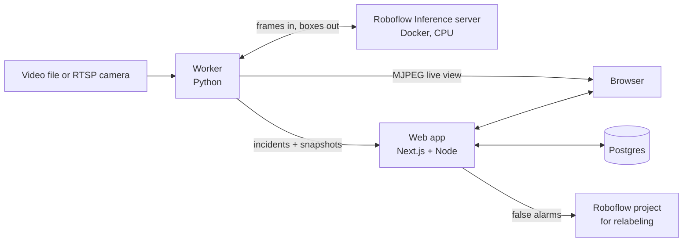

# Linewatch

Draw a zone on a camera view, catch people who walk into it without a hi-vis vest, review each
alert in one keystroke, and send false alarms back to a Roboflow project so the model can learn
from its mistakes.

Built on [Roboflow Inference](https://github.com/roboflow/inference) running locally in Docker,
Roboflow Universe models, and [supervision](https://github.com/roboflow/supervision).


## The problem

On a road crew or a warehouse floor, a supervisor can't watch every camera. Generic PPE detectors
draw boxes on every frame, which is not what a supervisor needs: one person without a vest
produces hundreds of flickering boxes. Linewatch turns detections into **one incident per person
per zone**, puts it in a review queue, and closes the loop back to the training data.

## How it works



For each frame the worker:

1. Runs a person model (`rfdetr-small`) and a PPE model (`construction-site-safety/27`) in
   parallel on the local Inference server.
2. Tracks people with ByteTrack so each person keeps an ID.
3. Checks whether the person's feet are inside the zone, and whether a vest box sits inside their box.
4. Fires an incident only when that person was in the zone without a vest in 4 of the last 6
   frames, then stays quiet for that person for 60 seconds.
5. Sends the incident, an annotated snapshot, and the clean frame to the web app.

In the console, **Confirm incident** (C) or **Mark as false alarm** (F). A false alarm uploads the
clean frame (never the one with boxes drawn on it) to your Roboflow project, tagged `false-alarm`.

## Run it

You need Docker, a free Roboflow account and its
[API key](https://app.roboflow.com/settings/api).

```bash
cp .env.example .env
# set ROBOFLOW_API_KEY, and WORKER_TOKEN (openssl rand -hex 24)
# put a video in samples/ and point VIDEO_SOURCE at it (see samples/LICENSES.md)
docker compose up --build
```

Open <http://localhost:3000>, draw a zone, and watch incidents arrive. The first start downloads
the model weights into the Inference container. Running models locally uses no Roboflow credits.

Optional: set `ROBOFLOW_WORKSPACE` and `ROBOFLOW_PROJECT` to collect false alarms for relabeling.

**Running parts locally** (for development): `make worker` runs the worker against an Inference
server you started with `inference server start`; `make web` runs the console in dev mode against
the Postgres from compose (port 5433). `make test` and `make lint` run the checks CI runs.

## Results

All numbers below were measured on my laptop's CPU (no GPU) with the scripts in [`eval/`](eval).
Each line says what was measured and on how much data.

**Choosing models.** `eval/compare_models.py` on 16 frames from 4 clips (4 per clip), counting
boxes with confidence ≥ 0.3. These are detection counts, not accuracy:

| Model | People found | Vests found | p50 | p95 |
| --- | --- | --- | --- | --- |
| `rfdetr-small` (person) | 95 | – | 490 ms | 773 ms |
| `yolov11n-1280` (person) | 73 | – | 339 ms | 484 ms |
| `yolov8n-1280` (person) | 70 | – | 530 ms | 1073 ms |
| `construction-site-safety/27` (PPE) | 44 | 32 | 288 ms | 401 ms |
| `ppe-bacnb/1` (PPE, earlier run, 12 frames) | 0 | 0 | 153 ms | 200 ms |

So the worker uses RF-DETR small for people and `construction-site-safety/27` for vests.

**Live run.** `make report` on a 190 s run of the street-crew clip in Docker (228 frames, first
10 skipped), on an Intel Core Ultra 7 155U laptop CPU under WSL2, no GPU:

| Measure | Result |
| --- | --- |
| End-to-end throughput | 1.20 frames/s |
| Model time per frame (both models in parallel) | p50 763 ms, p95 1010 ms |
| RF-DETR small (person) / PPE model | p50 762 ms / 518 ms |
| Full loop (decode, infer, track, draw) | p50 811 ms, p95 1086 ms |
| People detected per frame | 7.6 on average; at least one in every frame |

**Incidents.** 6 incidents in that run; of the 3 reviewed in the console so far, 3 were real
(`make precision`). That sample is too small to call a precision rate; it will be updated as
more incidents are reviewed.

**Not measured yet:** detection precision, recall and mAP@50 on a labeled test set
(`make eval`). Those need a hand-labeled set of frames that weren't used for tuning.

## Design decisions

- **One incident per person, not per frame.** A sliding majority window per tracked person, plus
  a cooldown. Vest detections flicker; without this, one worker produced repeat alerts.
- **Benefit of the doubt for vests.** A vest counts at confidence 0.25, a person at 0.35. Proving a
  vest is present should be easier than proving it is missing.
- **Feet decide "in the zone".** The bottom-center of a person's box, so someone leaning over the
  zone edge doesn't count.
- **The worker never blocks on the web app.** Incidents go through a background queue with retries.
- **False alarms go back to the data.** That loop, deployment back to dataset, is the point of the
  project.

## Limitations

- CPU only: about 1 to 2 frames per second with two models. Fine for zones people stay in for
  seconds; not for fast-moving hazards.
- One camera, one zone at a time.
- Stock footage, not a real site; sample clips are short and looped.
- On high, distant camera angles people are small and recall drops. See `FRICTION.md`.

## What I'd build next

- A "person near moving machinery" rule (the PPE model already detects machinery and vehicles)
- Several cameras and zones, each with its own rules and schedule
- RTSP input and a Jetson image for running on site
- Shift summaries and a Slack or Teams sink through a Roboflow Workflow
- Retraining on the collected false alarms, then measuring the change

## Credits

- Models: [RF-DETR](https://github.com/roboflow/rf-detr) via Roboflow Inference aliases;
  [Construction Site Safety](https://universe.roboflow.com/roboflow-universe-projects/construction-site-safety)
  (CC BY 4.0) on Roboflow Universe
- Footage: see [`samples/LICENSES.md`](samples/LICENSES.md)
- Typeface: Barlow by Jeremy Tribby (SIL Open Font License), via Fontsource

While building this I hit a fresh-install crash in `inference-cli` and opened a fix upstream:
[roboflow/inference#3217](https://github.com/roboflow/inference/pull/3217).
